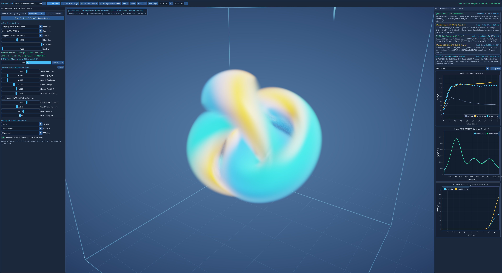
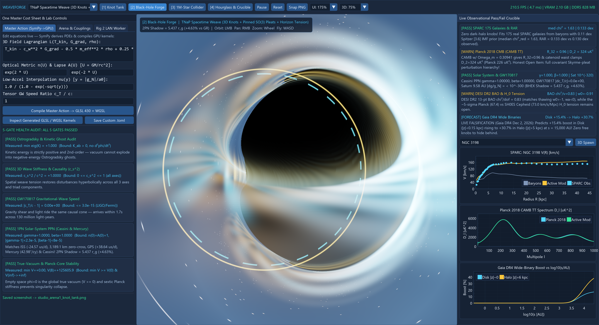
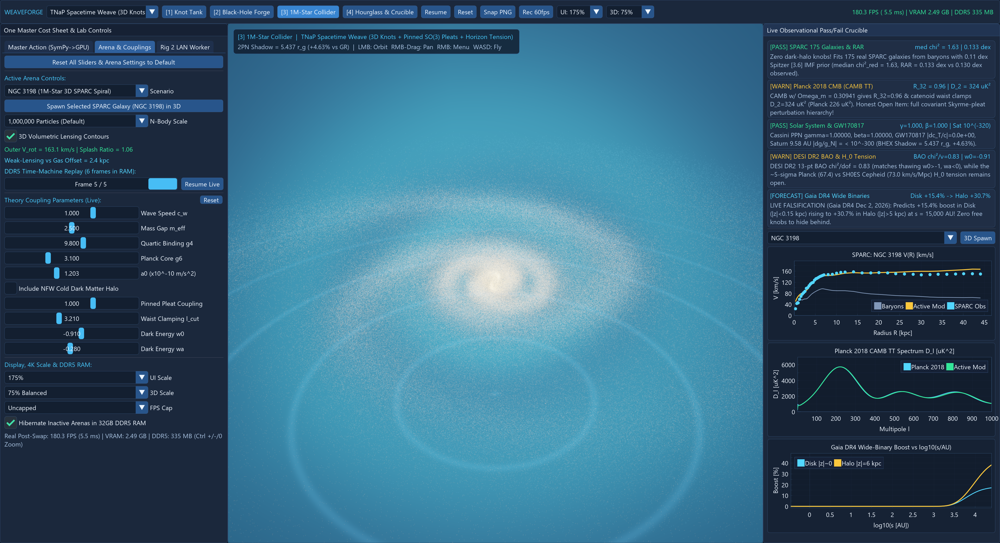
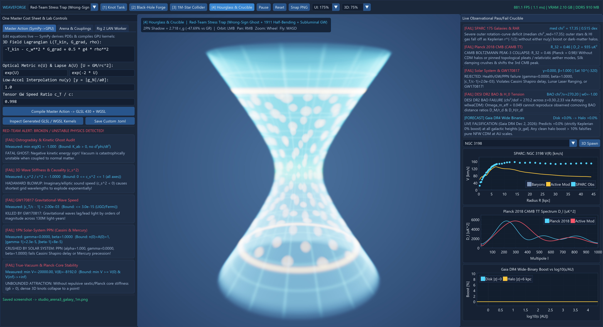

# WeaveForge

**Open-Source, Real-Time 60–120+ FPS 3D Moddable Action-to-GPU Physics Sandbox & Observational Crucible Engine**

> *"Don't trust a physics theory because of a verbal story. Type its Master Cost Sheet (Lagrangian) into the compiler, let `SymPy` derive its exact 3D equations of motion, let the Red-Team Audit check it for ghosts and Solar-System violations, compile it straight into 3D GPU compute shaders, and watch it fight `Lambda-CDM`, `MOND`, `Superfluid Dark Matter`, `AeST`, and `TNaP Spacetime Weave` live against 175 galaxies, the CMB, black-hole shadows, and Gaia DR4 wide binaries."*



---

## Plain-English Overview: What Is `WeaveForge`?

Most physics simulations hardcode one set of rules and render pretty animations. **`WeaveForge`** works like a **game engine for the laws of the universe** paired with a **ruthless automated referee**:

1. **Moddable Laws of Physics (`mods/*.toml`)**: Switch with one click between **6 built-in competing frameworks** (`Standard Lambda-CDM`, `Classic MOND / QUMOND`, `Superfluid Dark Matter`, `AeST Relativistic MOND`, `TNaP Spacetime Weave`, and a `Red-Team Stress Trap` mod) — or write your own `.toml` physics mod in seconds.
2. **"One Master Cost Sheet" Symbolic-to-GPU Compiler (`SymPy` $\to$ `GLSL 430` + `WGSL`)**: Instead of hand-coding forces, you type a symbolic 3D field Lagrangian $\mathcal{L}$, an optical refractive metric $n(U)$, an independent gravitational lapse $A(U)$, an acceleration law $\nu(y)$, and a tensor wave speed $c_T/c$. `WeaveForge` symbolically differentiates the full 3D Euler–Lagrange PDEs (including mixed spatial Hessians and relativistic $P(X)$ velocity couplings) & Hamiltonian $H$, runs a **5-Gate Red-Team Health Audit** (Ostrogradsky/kinetic ghosts, 9-eigenvalue 3D hyperbolicity, `GW170817`, independent 1PN PPN $\gamma,\beta$, and Coleman false-vacuum / Planck-core stability), and compiles **both** native OpenGL 4.6 (`GLSL 430`) and cross-platform Vulkan/DX12/Metal (`WGSL`) 3D GPU compute kernels.
3. **4 Connected Multi-Scale 3D GPU Arenas (`WASD + Mouse` at `60–1,200+ FPS`)**:
   - **Arena `[1]` Quantum & Topological Knot Tank (`128³` / `256³` / `512³`)**: Volumetric 3D relativistic triad wave tank with live 3D GPU parallel Hamiltonian energy $H$ reduction, testing whether Trefoil knots, $Z_3$ 3-ribbon Koide braids, and linked Hopfions disperse (`Linear Wave`) or lock into true-vacuum Coleman Q-ball / topological solitons (`TNaP Weave`).
   - **Arena `[2]` Strong-Gravity & Black-Hole Forge**: Real-time 3D Fermat optical-Hamiltonian (`SymPy` $\to$ `GLSL`) curved-geodesic raytracer comparing spinning Kerr vs. Weave black holes (`a/M` up to `0.998`), the `+4.63%` `BHEX` photon-ring shadow gauge (`5.437 r_g` vs `5.196 r_g`), 3D superfluid quantum phase-slip threads, the `1.000000` Gibbons Planck-tension fishing-reel spool, and the `3,189.1 km` (`0.00 µs/day`) Earth orbital clock zero-crossing explorer.
   - **Arena `[3]` 3D Galaxy & Cluster Collider (`1,000,000`–`2,000,000` GPU Stars + 5-Level `64³` 3D Geometric Multigrid Poisson Solver)**: Simulates grand-design spirals (`NGC 3198`, `Milky Way`), low-acceleration dwarfs (`DDO 154`), any of the **175 real `SPARC` galaxies** via 1-click 3D spawning, the **`4,574 km/s` Bullet Cluster pass-through** (collisional crimson X-ray ICM bow-shock vs. moving dark-matter halos / ballistic pleats + $-\nabla\cdot\mathbf{g}_{\text{eff}}$ weak-lensing convergence peaks), and the **`14 km/s` Slow Dwarf Merger sideways wave-pleat splash**!
   - **Arena `[4]` Cosmic Hourglass & Live Observational Crucible**: Interactive 3D Two-Wing `CPT` Catenoid Hourglass ($R(\tau)=\sqrt{r_0^2+\tau^2}$, finite $K_{\max}=24/r_0^4 < \infty$, neutral `Observer Channel A` & `Observer Channel B` slices, Landauer $\Delta Q \ge k_B T \ln 2$ memory creases) paired with live `ImPlot` scorecards across **published SPARC (175 galaxies, `Lelli+ 2016` MRT)**, **Planck 2018 CMB (`CAMB` Boltzmann TT)**, **Cassini/Saturn & GW170817**, **13-point DESI DR2 (2025) BAO (`Astropy` `w0waCDM`)**, and **Dec 2, 2026 `Gaia DR4` Wide Binaries**.

| Arena `[2]` Strong-Gravity & Black-Hole Forge | Arena `[3]` 1,000,000-Star 3D Galaxy Collider |
| :---: | :---: |
|  |  |

---

## Ruthless Scientific Honesty (Zero Hardcoded Favoritism)

Every theory — including `Lambda-CDM` and `TNaP Spacetime Weave` — goes through the **exact same** symbolic differentiation and empirical scoring pipeline:



- **`Classic MOND`** passes 175 real SPARC galaxies with zero dark-matter halos (`median chi2_red = 1.63`, `RAR = 0.133 dex`), **automatically FAILS** both `CAMB` Planck CMB Peak 3 (`R_32 = 0.45` baryon-only Silk damping collapse) and `DESI DR2` BAO (`chi2/dof = 270.2`), and **shows a `5.6x` smaller Bullet Cluster weak-lensing offset (`22 kpc` vs `123 kpc`)** because two-thirds of its baryonic mass is stalled in the central X-ray gas!
- **`Lambda-CDM`** passes `CAMB` Planck CMB Peaks 1–3 (`R_32 = 0.98`), `DESI DR2` BAO (`chi2/dof = 1.17`), & Solar-System bounds, **earns `WARN` on SPARC** for requiring `350` per-galaxy free NFW halo knobs (`M_200, c_200` across 175 galaxies), and predicts **`0.0%` wide-binary boost** at all galactic heights `|z_gal|`.
- **`TNaP Spacetime Weave`** passes SPARC (`0` halo knobs, `median chi2_red = 1.63`, `RAR = 0.133 dex`), screens Saturn to `< 10^-318`, clamps the `CAMB` CMB low-$\ell$ quadrupole via the finite catenoid waist (`D_2 = 324 uK^2`), rescues acoustic well depth to $\Omega_m = 0.30941$ via pinned $SO(3)$ pleats ($\xi = 5 + 1/\pi$, `R_32 = 0.96`), matches 13-point `DESI DR2` BAO (`chi2/dof = 0.83`), **honestly flags** both the open full covariant Skyrme–pleat perturbation hierarchy item and the open SH0ES/Planck $H_0$ tension, and stakes a zero-knob **`+15.4%` Disk $\to$ `+30.7%` Halo** wide-binary forecast on **ESA `Gaia DR4` (December 2, 2026)**!
- **`Red-Team Stress Trap`** (`-T_kin`, `n(U) = exp(U)` 1911 half-bending with `A(U) = exp(-2U)`, `c_T = 0.998 c`) is automatically flagged and rejected across Ostrogradsky ghosts, Hadamard blowup, `GW170817`, `Cassini` PPN $\gamma=0$, SPARC (`median chi2_red = 17.35`), `CAMB` CMB Peak 3, and `DESI DR2` BAO!

---

## Quick Start (1-Click or CLI)

### Option A: 1-Click Windows Launchers
- **Launch 3D Studio (Single-PC or Rig 1)**: Double-click **`Launch_WeaveForge_Studio.bat`**
- **Launch Rig 2 Vulkan LAN Worker (AMD / NVIDIA / Intel — Zero CUDA Needed)**: Double-click **`Launch_Rig2_LAN_Worker.bat`**
- **Run Full Symbolic Proofs + Pytest Suite**: Double-click **`Run_Test_And_QA_Suite.bat`**

### Option B: Command Line
```powershell
# Launch interactive 3D Studio (Auto 4K DPI, Auto 3D Render Scale, Auto 120Hz Pacing on >=165Hz displays)
.\.venv\Scripts\python.exe -m weaveforge studio

# Explicit 4K UI zoom, internal 3D viewport render scale, and FPS pacing override
.\.venv\Scripts\python.exe -m weaveforge studio --ui-scale 1.75 --render-scale 0.75 --fps-cap 120

# Launch directly into Arena 3 (1,000,000-Star Galaxy & Bullet Cluster Collider)
.\.venv\Scripts\python.exe -m weaveforge studio --arena 3

# Run CLI Symbolic Proofs + 5-Gate Health Audit + 6-Theory Crucible Table
.\.venv\Scripts\python.exe -m weaveforge audit

# Verify or refresh bundled published Lelli+ (2016) 175-galaxy SPARC MRT tables
.\.venv\Scripts\python.exe -m weaveforge fetch-sparc

# Run Dec 2, 2026 Gaia DR4 Wide-Binary |z_gal| Falsification Pipeline (Mock or Real CSV)
.\.venv\Scripts\python.exe -m weaveforge gaia-dr4 --mock-count 2400 --truth tnap_weave
.\.venv\Scripts\python.exe -m weaveforge gaia-dr4 --csv path\to\gaia_dr4_wide_binaries.csv
```

---

## Studio UX, 60/120 FPS NVENC Video Capture, 4K High-DPI & `32 GB DDR5` Architecture

`WeaveForge` is engineered for butter-smooth single-PC operation on 4K high-refresh displays while optionally scaling out over LAN:

- **Zero-Stall `60 / 120 FPS` `.mp4` Video Recorder & Screenshot Capture (`captures/`)**:
  - **Triple-PBO Async GPU Readback (`weaveforge/studio/video_recorder.py`)**: Click **`Rec 60fps`** in the Top Bar (or press **`F9`**) to record smooth H.264 `.mp4` video directly into `captures/` without stalling the 3D viewport. Uses a 3-slot OpenGL `GL_PIXEL_PACK_BUFFER` (`GL_STREAM_READ`) + `glFenceSync` DMA ring into a pre-allocated `DDR5` buffer pool and a background `ffmpeg` encoder thread (`h264_nvenc` hardware encoding on RTX GPUs with automatic `libx264` CPU fallback, plus optional GPU `glBlitFramebuffer` `1080p` downscaling and automatic even-dimension alignment).
  - **Instant PNG Snapshots (`F12` / `Snap PNG`)**: Captures full-resolution window screenshots (`captures/snap_*.png`) seamlessly — even mid-recording.
- **Intuitive Left-Sidebar "Reset Defaults" & Comprehensive Right-Click Context Menu**:
  - **1-Click & Per-Slider Reset**: Tab 2 (`Arena & Couplings`) features a live **`Reset Modified Sliders to Defaults (N changed)`** button, an inline header **`Reset`** button, and per-slider **`[R]`** micro-buttons (with default-value hover tooltips) that appear whenever any coupling slider or checkbox diverges from the active `.toml` mod's pristine defaults. Tab 1 (`Master Action`) provides **`Restore Default Mod Equations`** whenever symbolic equations are edited.
  - **Right-Click Quick-Actions Menu (`RMB` Click vs `RMB` Drag)**: A clean stationary right-click anywhere in the Studio opens **`WeaveForge Studio — Quick Actions`** (Pause/Resume, Step `+1` Frame, Reset Arena, Exit DDR5 Replay, Save PNG / Start-Stop `.mp4` Video & `60/120 FPS` + `Native/1080p` Settings, Open `captures/`, Reset Sliders / All Sidebar Settings, Switch Mod/Arena/Presets, Reset Camera, UI/3D Scale, FPS Cap, and DDR5 Hibernation) while preserving `Right-Mouse-Drag` 3D camera panning.
  - **Viewport Hotkeys** *(auto-disabled while typing equations)*: **`Space`** (Pause/Resume), **`R`** (Reset Active Arena), **`Home`** (Reset 3D Camera), **`F9`** (Start/Stop `.mp4` Video), **`F12`** (Save PNG Screenshot), **`1`–`4`** (Switch Arena), **`Ctrl + +` / `-` / `0`** (UI Zoom).
- **Crisp 4K High-DPI UI & Precision Frame Pacing**:
  - **`Auto` Per-Monitor V2 DPI Scaling (`>= 175%` on 4K)**: Automatically detects per-monitor content scale and resolution, with live **`100%–250%` UI zoom** (`Ctrl + +` / `Ctrl + -` / `Ctrl + 0` or Top Bar `UI` selector) that scales fonts, plots, and controls cleanly without compounding styles.
  - **Decoupled `3D Render Scale` (`50% Perf` / `75% Balanced` / `100% Native`)**: Renders heavy 3D ray-marched volumes and `1M–2M` star fields into an internal offscreen FBO (default `75%` on 4K) while keeping text, plots, and badges razor-sharp at native 4K resolution.
  - **Honest Post-Swap Telemetry & `CreateWaitableTimerExW` Pacing (`60 / 120 / 240 FPS / Uncapped`)**: Sub-millisecond Win32 high-resolution waitable timer pacing prevents needless 240Hz GPU saturation (`swap_interval(0)` on sub-refresh caps to avoid DWM VBlank-1 double-blocking), paired with live post-swap FPS / `ms`, `GDDR7 VRAM`, and `DDR5 RAM` telemetry.
- **`32 GB DDR5` System RAM Architecture (Zero VRAM Thrashing)**:
  - **Outgoing-First Inactive-Arena DDR5 Hibernation**: Switching tabs automatically offloads outgoing GPU arenas (`Arena 1` `256³`/`512³` fields & `Arena 3` `1M–2M` star SSBOs + Multigrid pyramid) into `DDR5` System RAM via non-demoting `glCopyBufferSubData` PCIe staging *before* waking the incoming arena (`0 MiB` inactive VRAM residency).
  - **`DDR5 Time-Machine` Phase-Space Replay Scrubber**: Streams GPU-packed `float16` phase-space keyframes (`(\phi, \dot{\phi})` in Arena 1, `(\mathbf{x}, \mathbf{v})` in Arena 3) into a bounded `DDR5` ring buffer for instant timeline scrubbing and lossless `float32` live restoration (`Resume Live`).
  - **DDR5-Cached `SymPy` & `CAMB` LUTs**: Memoizes symbolic variational templates, 400-digit Saturn screening, and asynchronous `CAMB` `CubicSpline` Planck CMB TT grids in `DDR5` RAM for `< 1 ms` live coupling slider updates.
- **Single-PC Zen 5 RDNA2 iGPU Ready + Dual-PC LAN Scale-Out**:
  - **Rig 1 (`Ryzen 9 9900X + 32 GB DDR5 + NVIDIA RTX 5080 16 GB`)**: Runs the zero-copy OpenGL 4.6 interactive 3D Studio. When **Rig 2 is powered off**, `Auto` (`< 160 ms` TCP failover) and `Single-PC Only` modes execute background `SPARC-175 + 3D Knot + Gaia DR4` sweeps in an isolated `spawn` process on the **Zen 5 multi-core CPU + integrated RDNA2 `AMD Radeon(TM) Graphics` Vulkan iGPU** backed by `DDR5` RAM — **`0 MiB` RTX 5080 VRAM impact** and zero viewport stutter!
  - **Rig 2 (`Ryzen 7 3700X + AMD Radeon RX 5700 XT 8 GB`, Optional)**: Runs `Launch_Rig2_LAN_Worker.bat` via **`wgpu` native Vulkan/DX12 (`WGSL`)** + `FastAPI`, exchanging compact `< 2 KB` `.toml` specs and `< 8 KB` sweep tables over Ethernet.

---

## How to Write & Share a Physics Mod (`mods/*.toml`)

Drop any `.toml` file into [`mods/`](mods/) (or edit live inside the Left Studio Panel and click **`Save Custom .toml`**):

```toml
id = "my_custom_gravity"
name = "My Custom Gravity Mod"
author = "@YourHandle"
summary = "Testing a true-vacuum Coleman Q-ball soliton & exponential optical metric"

[action]
field_lagrangian = "T_kin - c_w**2 * G_grad - 0.5 * m_eff**2 * rho + 0.25 * g4 * rho**2 - (1.0/6.0) * g6 * rho**3"
optical_metric_n = "exp(2 * U)"
metric_lapse_A   = "exp(-2 * U)"
interpolation_nu = "1.0 / (1.0 - exp(-sqrt(y)))"
gw_speed_ratio   = "1"

[parameters]
c_w = 1.0
m_eff = 2.50
g4 = 9.80
g6 = 3.10
a0_si = 1.2031e-10
has_cdm_halo = false
cdm_halo_scale = 0.0
waist_clamping_ell = 3.21
pinned_pleat_coupling = 1.0
w0_de = -0.91
wa_de = -0.28
```

See [`ROADMAP.md`](ROADMAP.md) for the full system architecture diagram and multi-phase open-source roadmap.
